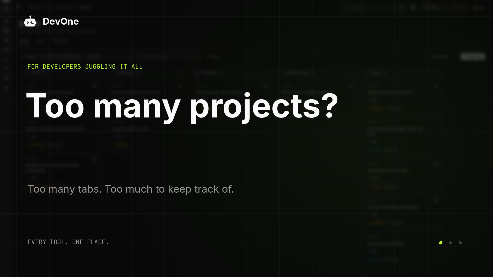

<p align="center">
   1_" />
</p>

<h1 align="center">DevFeed</h1>

<p align="center">One workspace for everything developers need.</p>

<p align="center">
  <a href="https://github.com/rbillyjames0221/DevFeed/actions/workflows/ci.yml"></a>
  <a href="https://github.com/rbillyjames0221/DevFeed/releases/latest"></a>
  <a href="LICENSE"></a>
  <a href="https://github.com/rbillyjames0221/DevFeed/pkgs/container/devfeed"></a>
</p>

<p align="center">
  <a href="https://github.com/rbillyjames0221/DevFeed/releases/latest">Desktop app</a> ·
  <a href="https://github.com/rbillyjames0221/DevFeed">GitHub</a> ·
  <a href="docs/deployment.md">Docs</a> ·
  <a href="docs/promo/devfeed-promo-story.mp4">Demo video (MP4)</a> ·
  <a href="CONTRIBUTING.md">Contributing</a>
</p>

<p align="center">
  <a href="https://vercel.com/new/clone?repository-url=https%3A%2F%2Fgithub.com%2Frbillyjames0221%2FDevFeed&project-name=devfeed&repository-name=devfeed&env=DATABASE_URL,DEVFEED_ENCRYPTION_KEY&envDescription=A%20PostgreSQL%20connection%20string%20and%20an%20encryption%20key%20from%20%60openssl%20rand%20-base64%2032%60&envLink=https%3A%2F%2Fgithub.com%2Frbillyjames0221%2FDevFeed%2Fblob%2Fmain%2Fdocs%2Fdeployment.md%23vercel"></a>
</p>

<p align="center">
  <a href="docs/promo/devfeed-promo-story.mp4"></a>
</p>

DevFeed is a self-hosted developer workspace that connects project work, Git activity, databases, APIs, documentation, and deployments in one unified dashboard.

---

## Quickstart & Local Setup

### 1. Clone & Install

```bash
git clone https://github.com/rbillyjames0221/DevFeed.git
cd DevFeed
bun install # or npm install
cp env.example.txt .env
```

---

### 2. Set Up Local PostgreSQL (Native)

DevFeed connects directly to your local PostgreSQL installation (default port `5432`):

1. **Create the database**:
   ```sql
   CREATE DATABASE devfeed;
   ```
   *(Or run via command line: `psql -U postgres -c "CREATE DATABASE devfeed;"`)*

2. **Configure your `.env`**:
   ```env
   DATABASE_URL="postgresql://postgres@127.0.0.1:5432/devfeed"
   DATABASE_URL_UNPOOLED="postgresql://postgres@127.0.0.1:5432/devfeed"
   ```
   *(If your local `postgres` user requires a password, use `postgresql://postgres:<your_password>@127.0.0.1:5432/devfeed`)*

3. **Generate Encryption Key & Run Migrations**:
   DevFeed requires a 32-byte Base64 encryption key to secure credentials:
   ```bash
   # Generate key (macOS / Linux / Git Bash)
   openssl rand -base64 32

   # Or via Node.js (Windows PowerShell / Command Prompt)
   node -e "console.log(require('crypto').randomBytes(32).toString('base64'))"
   ```
   Save the key in `.env`:
   ```env
   DEVFEED_ENCRYPTION_KEY=your_generated_base64_key
   ```
   Then apply all migrations:
   ```bash
   bun run db:deploy # or npx prisma migrate deploy
   ```

*(Optional: If you prefer Docker over native PostgreSQL, you can run `docker compose up -d postgres redis` instead).*

---

### 3. Start the Development Server

```bash
bun run dev # or npm run dev
```

Open [http://localhost:3000](http://localhost:3000) in your browser.

---

## Authentication & Sign-In Methods

DevFeed supports two convenient local sign-in methods:

### Method 1: Local Admin Login (Fastest, No External Service Needed)

DevFeed has a built-in direct administrative login that works offline without any Git provider.

1. Ensure admin credentials are set in your `.env` (or use the defaults):
   ```env
   DEVFEED_ADMIN_USERNAME=admin
   DEVFEED_ADMIN_PASSWORD=admin
   ```
2. Navigate to [http://localhost:3000/login](http://localhost:3000/login).
3. Click the **Admin** tab.
4. Enter `admin` for both Username and Password to log in immediately.

---

### Method 2: GitHub Login (Classic Personal Access Token)

To sync your GitHub repositories, issues, and activity, sign in using a GitHub Personal Access Token (PAT).

> [!TIP]
> **Use a Classic PAT rather than a Fine-Grained PAT.**  
> Classic PATs have user-level access, allowing DevFeed to access your personal repos, organization repos, **and repositories where you are an external collaborator**. Fine-grained PATs are restricted to a single resource owner and cannot access collaborator repos owned by other personal accounts.

#### 1. Generate Your Token Directly
Click this direct link to open GitHub with the required scopes already selected:
👉 [**Generate DevFeed Classic PAT on GitHub**](https://github.com/settings/tokens/new?description=DevFeed&scopes=repo,read:org,read:user)

This automatically configures:
- **Note**: `DevFeed`
- **Required scopes**:
  - `repo` (Full control of repositories, including private & collaborator repos)
  - `read:org` (Read organization membership and team projects)
  - `read:user` (Read user profile and email)

Choose an expiration period, click **Generate token**, and copy the token (`ghp_...`).

#### 2. Allow Account Bootstrap
For your first sign-in, enable bootstrap mode in `.env` so your account is granted administrator rights:
```env
DEVFEED_ALLOW_BOOTSTRAP=true
```

#### 3. Sign In
1. Go to [http://localhost:3000/login](http://localhost:3000/login).
2. On the **GitHub** tab, paste your `ghp_...` token into the **Personal access token** input.
3. Click **Sign in**.

*(After the initial sign-in, you can set `DEVFEED_ALLOW_BOOTSTRAP=false` to prevent unauthorized admin registrations).*

---

## Self-Hosting with Docker

DevFeed provides pre-built Docker images with PostgreSQL, Redis, and automatic migrations configured in `compose.yaml`:

```bash
# 1. Clone repository
git clone https://github.com/rbillyjames0221/DevFeed.git
cd DevFeed

# 2. Copy and configure .env
cp env.example.txt .env

# Set POSTGRES_PASSWORD, DEVFEED_ENCRYPTION_KEY, and DEVFEED_ALLOW_BOOTSTRAP=true in .env

# 3. Pull images and launch
docker compose pull
docker compose up -d
```

Open [http://localhost:3000](http://localhost:3000) to complete the initial administrator setup.

---

## Tech Stack

See [docs/tech-stack.md](docs/tech-stack.md) for details on the architecture, dependencies, and services.

- **Framework**: Next.js 16 (App Router) & React 19
- **Database**: PostgreSQL with Prisma ORM
- **Cache & Queues**: Redis
- **Styling**: Tailwind CSS v4 & shadcn/ui
- **Icons**: Tabler Icons via `@/components/icons`

---

## Checks & Quality

```bash
bun run test         # Core invariants and documentation checks
bun run test:db      # Database connectivity check
bun run lint:strict  # OxLint zero-warning check
bun run typecheck    # TypeScript compiler check
bun run build        # Production build verification
```

---

## Contributing

Contributions are welcome! Fork the repository, create a branch for your feature, and open a pull request against `main`. See [CONTRIBUTING.md](CONTRIBUTING.md) and [SECURITY.md](SECURITY.md) for guidelines.

---

## License

DevFeed is released under the [MIT License](LICENSE).
