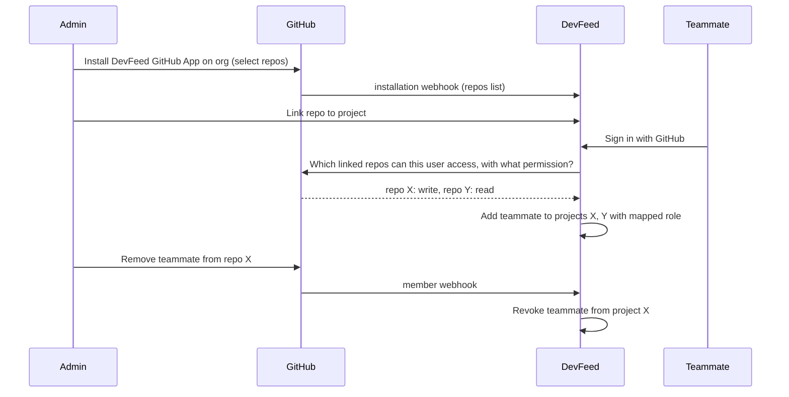
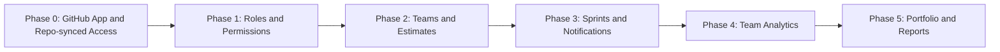

# DevFeed — Current State & Team Edition Roadmap

> Snapshot written 2026-10-26 against `dev-feed@1.1.1`.
> Part 1 describes what is in the codebase **today**. Part 2 proposes how to turn DevFeed
> from a "solo developer + a few collaborators" tool into a workspace for a structured team
> (Project Manager → Team Lead → Members) with proper team analytics.

---

## Part 1 — What DevFeed is today

DevFeed is a **self-hosted developer workspace**: board, Git, databases, API client, docs,
drawings, pipelines and an SSH terminal, all inside one *project* context.
The idea is to connect your existing tools in one place, not to replace GitHub/GitLab, Jira, Postman or DBeaver.

```text
Issue → Branch → Commits → PR/MR → Pipeline → Deployment
Database → Schema scan → ERD → SQL editor → Schema history → Schema diff
```

### 1.1 Tech stack

| Layer          | Choice                                                                       |
| -------------- | ---------------------------------------------------------------------------- |
| Framework      | Next.js 16 (App Router), React 19, TypeScript (strict)                       |
| UI             | Tailwind CSS v4, shadcn/ui, Tabler icons (via `src/components/icons.tsx`)    |
| Data/UI state  | TanStack Query, TanStack Table, TanStack Form + Zod, nuqs                    |
| Charts         | Recharts                                                                     |
| Own database   | PostgreSQL via Prisma (`prisma/schema.prisma`, ~40 migrations)               |
| User databases | Native Postgres / MySQL drivers (`src/lib/database/*`)                       |
| Integrations   | GitHub + GitLab APIs (incl. self-hosted GitLab), webhooks                    |
| Editors        | CodeMirror (code/SQL), rich Markdown editor, Excalidraw + draw.io            |
| Terminal       | SSH over xterm.js, server-side sessions (`src/lib/ssh/*`)                    |
| i18n           | English + Filipino (`src/i18n/messages`)                                     |
| Delivery       | Docker (Node + Bun images, GHCR), Compose (Postgres + Redis), Vercel, Electron desktop app |
| Quality        | OxLint, Oxfmt, Husky, dependency-free check scripts in `scripts/`            |

### 1.2 Feature modules (`src/features/*`)

| Module               | What it does                                                                                                                                      |
| -------------------- | ------------------------------------------------------------------------------------------------------------------------------------------------- |
| **auth**             | Sign-in with a GitHub/GitLab personal access token or OAuth. Encrypted tokens, DB-backed HttpOnly sessions, rate limiting, registration policy. The first sign-in becomes admin (bootstrap). |
| **projects**         | Create/list projects, project cards, **project dashboard** (see 1.4), members list.                                                               |
| **project-settings** | General (name, issue prefix), repositories + production branch, DevOps policy (terminal access, SSH host allowlist, hidden pipeline branches), **members**, project audit log. |
| **issues** (Board)   | Several boards per project, custom columns (color/icon), custom type & priority options, Kanban / List / Calendar views, assignee, target date, archive/restore, comments, full per-issue history (`IssueEvent`), linked docs & drawings, Git links detected from issue keys (`DEV-142`) in branches/commits/PRs. Sprints exist in the schema and service. |
| **git**              | Repository workbench: file explorer, branch picker/creation, code editor, "open in VS Code", markdown task toggling, PR/MR + pipeline data from the provider. |
| **database**         | Saved connections (read-only by default), table browser + data grid with column filters, inline row edits with pending changes, SQL editor, saved queries, schema scans/snapshots, **ERD viewer**, **schema diff**, migration DDL. |
| **platform**         | **API client** (collections, folders, environments, auth, history, OpenAPI/Postman/cURL import, code snippets) and **Docs** (Markdown pages in folders, document import). |
| **drawings**         | Excalidraw (with live multi-cursor sync + presence) and draw.io canvases, foldered, linkable to issues. |
| **resources**        | Project environments (API, APP, GIT_TAG, DOCKER_IMAGE, NOTE): URLs, hosting, branch, encrypted variables/headers/accounts. Can be shared with the project or kept personal. |
| **devops**           | Pipelines per repository with job logs, SSH terminal workspace (host key pinning, policy-checked). |
| **account**          | Preferences, Git connections, active sessions, personal SSH servers. |
| **admin**            | Installation-wide user list, change user role, disable users, global audit log. |
| **demo / landing**   | Public demo mode with expiring sample workspaces; marketing landing page. |

### 1.3 Who can do what today (access model)

| Level            | Values               | Where enforced                                     |
| ---------------- | -------------------- | -------------------------------------------------- |
| Installation     | `ADMIN`, `MEMBER`    | `User.role` → `src/features/admin/service.ts`      |
| Project          | `OWNER`, `MEMBER`    | `ProjectMember.role` → `requireProjectRole()` in `src/features/project-settings/service.ts` |
| Terminal policy  | `DISABLED`, `OWNERS`, `MEMBERS` | `Project.terminalAccess`                |
| Personal records | `ownerId` set        | `ProjectResource`, `SshHost` (only the owner sees them) |

Members are added **by username** (must have signed in once). Owners manage settings and
members and see the project audit log. Everyone else is a plain member with full access to the
board, docs, DB connections and API client.

### 1.4 Analytics that already exist

`getProjectDashboard()` in `src/features/projects/dashboard.ts` already computes:

- Open tasks, created this week, done this week vs. last week
- **8-week throughput** (created vs. done per week) → `throughput-chart.tsx`
- **Median lead time** (created → done, last 30 days)
- **Workload per member** (open / started / overdue), plus Unassigned
- **Stuck work** (started, untouched ≥ 7 days)
- Upcoming/overdue target dates (next 14 days)
- Board progress per column, active sprint progress (done / total)
- Recent activity feed (task events, docs, drawings)
- "My tasks" for the current user

Supporting data that is recorded but **not yet used for analytics**: `IssueEvent` (every status /
assignee / priority / target-date change, with `viaGit`), `IssueGitLink`, `IssueComment`,
`AuditEvent`, `ApiHistoryEntry`.

### 1.5 Why it feels "solo"

DevFeed is **not strictly single-user**: projects already have members, assignees and a workload panel.
What makes it feel solo:

1. **Two roles only.** `OWNER` / `MEMBER` with no PM, lead or read-only roles, and no permissions per feature.
2. **No team grouping.** People belong to projects one at a time. There is no "Backend team" or
   "Mobile squad", and no organization layer above projects.
3. **Analytics are per project and "now".** There is no cross-project or per-person history, no sprint
   velocity/burndown, no capacity planning, and no reports or exports.
4. **No estimates.** Without story points or hours, nobody can plan capacity or measure velocity.
5. **No notifications or mentions.** Coordination happens outside the tool. The README roadmap lists this.
6. **Sprints are partly built.** The model and service exist, but there is no full planning or closing UI.
7. **No approvals or reviews flow** in DevFeed itself (that lives on GitHub/GitLab).
8. **Repository access is borrowed.** Every member reads and writes a linked repo through the token of
   whoever linked it (`openRepository()` in `src/features/git/service.ts`). GitHub permissions are not
   respected, edits are credited to the linker, and giving or removing someone's GitHub access changes
   nothing in DevFeed.
9. **Sign-in is token-first.** PATs are the default. The optional OAuth App button asks for the broad
   `repo` scope (every private repo the user has).

---

## Part 2 — Proposal: DevFeed for Teams

### 2.0 Phase 0 — GitHub App sign-in & repo-synced access

**Goal:** the admin links repositories once. **Access on GitHub decides who sees what in DevFeed.**
Teammates sign in with an "Authorize with GitHub" button, never by pasting a token.

#### Current behavior (for reference)

| Area | Today | Where |
| ---- | ----- | ----- |
| Sign-in | PAT by default. Optional OAuth App (`repo read:org read:user`) when `DEVFEED_GITHUB_CLIENT_ID/SECRET` are set | `src/lib/auth/oauth.ts`, `src/app/api/auth/[provider]/*` |
| Repo cache | `Repository` is owned by the linker's `GitConnection` | `prisma/schema.prisma` |
| Repo reads/writes | Every member uses the **linker's** token | `openRepository()` in `src/features/git/service.ts` |
| Project membership | Added by hand by username. Auto-join only if the teammate links the same repo themselves | `addProjectMemberByUsername()`, `linkRepositoryToNewProject()` |
| Collaborators | Read from GitHub only to fill the assignee picker | `listAssignableCollaborators()` |
| Webhooks | Set up by hand per repo, used only to sync issue links | `src/app/api/webhooks/github/route.ts` |

#### Why a GitHub App (not PATs, not an OAuth App)

| | PAT | OAuth App | **GitHub App** |
|---|---|---|---|
| Sign-in experience | Copy and paste a token | Authorize button | Authorize button |
| Repo scope | Whatever the token has | All of the user's repos | **Only the repos the admin installs it on** |
| Permissions | Broad | Broad (`repo`) | Fine-grained (contents, pull requests, actions, metadata, members) |
| Background work | Tied to one person | Tied to one person | **Installation token**, owned by the org |
| Teammates' actions | Run as the linker | Run as the linker | **User-to-server token**: run as the teammate, GitHub permissions respected |
| Webhooks | Set up by hand per repo | Set up by hand per repo | Built in: `installation_repositories`, `member`, `membership`, `push`, `pull_request`, `workflow_run` |
| Token lifetime | Long-lived | Long-lived | Expires and refreshes (short-lived, safer) |

#### Target flow



1. The **admin installs** the DevFeed GitHub App on the organization (or a personal account) and picks repositories.
2. The admin **links** an installed repo to a DevFeed project. The repo now belongs to the *installation*, not to a person.
3. A **teammate signs in** with GitHub (user-to-server OAuth on the same App). DevFeed lists the repos
   they can access in that installation (`GET /user/installations/{id}/repositories`) and their permission
   on each linked repo (`GET /repos/{owner}/{repo}/collaborators/{username}/permission`).
4. DevFeed **auto-adds** them to every project linked to one of those repos, with a default role:

   | GitHub permission | Default DevFeed role |
   | ----------------- | ------------------- |
   | `admin`           | Lead                |
   | `maintain` / `write` | Member           |
   | `triage` / `read` | Viewer              |
   | none              | removed (unless granted by hand, see below) |

   **Project Manager** has no GitHub equivalent, so a PM/Admin assigns it by hand. A manual role is
   kept as an *override* and is never downgraded by sync.
5. **Revocation:** a `member`/`membership` webhook, a check at sign-in, and a periodic re-check (e.g.
   hourly) remove repo-derived access when GitHub access is gone.
6. **Who performs actions:**
   - Viewing code, committing, creating branches and commenting on PRs use the **teammate's own
     user token**, so GitHub enforces their permissions and credits them correctly.
   - Webhooks, pipeline status, issue-link sync and nightly analytics snapshots use the
     **installation token**.

#### Data model changes

```prisma
model GitInstallation {
  id                 String      @id @default(cuid())
  provider           GitProvider
  /// GitHub App installation id.
  externalId         String
  accountLogin       String      // org or user it is installed on
  accountType        String      // "Organization" | "User"
  installedById      String?
  suspendedAt        DateTime?
  createdAt          DateTime    @default(now())
  repositories       Repository[]
  @@unique([provider, externalId])
}

enum MembershipSource { MANUAL REPOSITORY }
```

| Model | Change |
| ----- | ------ |
| `Repository` | Add `installationId String?`. Make `gitConnectionId` optional (legacy repos linked by PAT/OAuth keep working). Unique on `[provider, baseUrl, providerRepositoryId]` so a repo is cached once, not once per user. |
| `ProjectMember` | Add `source MembershipSource @default(MANUAL)`, `syncedPermission String?`, `lastSyncedAt DateTime?`. Sync only touches `REPOSITORY` rows. |
| `GitConnection` | Stays: holds each user's own user-to-server token (refresh token + expiry are already supported). |

#### Configuration

```env
DEVFEED_GITHUB_APP_ID=
DEVFEED_GITHUB_APP_SLUG=          # for the install link
DEVFEED_GITHUB_APP_PRIVATE_KEY=   # PEM; signs JWTs to mint installation tokens
DEVFEED_GITHUB_CLIENT_ID=         # the App's client id (user sign-in)
DEVFEED_GITHUB_CLIENT_SECRET=
DEVFEED_GITHUB_WEBHOOK_SECRET=    # already exists
DEVFEED_ALLOW_PAT_LOGIN=false     # new: team installs turn PAT sign-in off
```

#### GitLab equivalent

GitLab has no GitHub App. The closest match:

- **Sign-in:** an OAuth application at **group** level (already supported, scope `api read_user` →
  narrow it to `read_api read_user` plus `write_repository` only where needed).
- **Background work:** a **group access token** stored as the installation's credential.
- **Access sync:** `GET /projects/:id/members/all/:user_id` (access levels 50/40 → Lead, 30 → Member,
  10/20 → Viewer), plus group webhooks for member changes.

#### Compatibility

- PAT sign-in and today's OAuth App keep working for solo installs, self-hosted setups and the
  desktop app. `DEVFEED_ALLOW_PAT_LOGIN` lets team installs turn PATs off.
- Repos linked the old way keep using the linker's token until an admin "moves" them to an installation.
  Settings → Repositories shows a banner for these.
- Board, docs, DB connections, resources and the terminal stay **DevFeed-only** permissions. GitHub
  decides only **who gets into a project and their starting role**.

#### Security notes

- Store the App private key and every token encrypted (existing `DEVFEED_ENCRYPTION_KEY` / `src/lib/encryption`).
- Installation tokens last about 1 hour. Mint them on demand and cache them in memory or Redis, never in the browser.
- Verify every webhook signature (already done). Make sync idempotent.
- Record every automatic join and removal in `AuditEvent` (`project.member.sync.add` / `.remove`).

### 2.1 Target roles

| Role                  | Scope        | Purpose                                                                                     |
| --------------------- | ------------ | ------------------------------------------------------------------------------------------- |
| **Admin**             | Installation | Runs the instance: users, SSO/registration, global audit. *(exists)*                        |
| **Project Manager**   | Organization or project | Owns delivery: creates projects and sprints, sets priorities and deadlines, sees all analytics and reports. |
| **Team Lead**         | Team         | Owns a team's work: triages the backlog, assigns tasks, reviews workload, approves done.     |
| **Member**            | Team/project | Does the work: updates own tasks, comments, logs time, uses DB/API/Git tools.               |
| **Viewer** *(stakeholder)* | Project | Read-only access to the board, docs, roadmap and reports. Cannot see secrets or the terminal. |

### 2.2 Suggested permission matrix

| Capability                                   | Admin | PM  | Lead      | Member     | Viewer |
| -------------------------------------------- | :---: | :-: | :-------: | :--------: | :----: |
| Create project / team                        | ✅    | ✅  | —         | —          | —      |
| Manage project settings & repositories       | ✅    | ✅  | —         | —          | —      |
| Add/remove members, change roles             | ✅    | ✅  | own team  | —          | —      |
| Create / start / close sprints               | ✅    | ✅  | ✅        | —          | —      |
| Create issues                                | ✅    | ✅  | ✅        | ✅         | —      |
| Assign issues to others                      | ✅    | ✅  | own team  | self only  | —      |
| Move issue to "Done" / approve               | ✅    | ✅  | ✅        | configurable | —    |
| Edit priority / target date                  | ✅    | ✅  | ✅        | —          | —      |
| View secrets (resource variables, DB passwords) | ✅ | ✅  | ✅        | configurable | —    |
| Write to production DB connections           | ✅    | —   | ✅        | —          | —      |
| SSH terminal                                 | policy| policy | policy | policy     | —      |
| Team analytics (all members)                 | ✅    | ✅  | own team  | own stats  | summary |
| Cross-project portfolio report               | ✅    | ✅  | —         | —          | —      |
| Audit log                                    | ✅    | ✅  | own team  | —          | —      |

> Implement this as **permissions** (`issue.assign`, `sprint.manage`, `secret.reveal`, …) mapped
> from roles, not as `role === 'X'` checks scattered in code. `requireOwner()` then becomes
> `requirePermission(userId, projectId, 'settings.manage')`.

### 2.3 Data model changes (Prisma)

```prisma
/// Optional top layer: a company/department that owns projects and teams.
model Organization {
  id        String   @id @default(cuid())
  name      String
  slug      String   @unique
  createdAt DateTime @default(now())
  members   OrganizationMember[]
  teams     Team[]
  projects  Project[]
}

enum OrgRole { OWNER PROJECT_MANAGER MEMBER }

model OrganizationMember {
  organizationId String
  userId         String
  role           OrgRole @default(MEMBER)
  @@id([organizationId, userId])
}

/// A group of people, e.g. "Backend", working across one or more projects.
model Team {
  id             String  @id @default(cuid())
  organizationId String
  name           String
  leadId         String?           // Team Lead
  members        TeamMember[]
  projects       TeamProject[]
  @@unique([organizationId, name])
}

model TeamMember {
  teamId          String
  userId          String
  /// Hours per week available for planning (capacity).
  weeklyCapacity  Int?
  @@id([teamId, userId])
}

model TeamProject {
  teamId    String
  projectId String
  @@id([teamId, projectId])
}

// Extend existing enum
enum ProjectRole { OWNER PROJECT_MANAGER LEAD MEMBER VIEWER }
```

Changes to existing models:

| Model      | Add                                                                                       |
| ---------- | ----------------------------------------------------------------------------------------- |
| `Issue`    | `estimate Float?` (points or hours), `teamId String?`, `parentId String?` (epics/sub-tasks), `startedAt`, `completedAt` (denormalized for fast analytics), `labels String[]` |
| `Sprint`   | `teamId String?`, `capacity Int?`, `committedPoints Float?` (snapshot at start)           |
| `IssueEventType` | `ESTIMATE`, `SPRINT`, `COMMENT`, `REOPENED`                                         |
| New `TimeEntry` | `issueId, userId, minutes, note, loggedAt`. Optional, for teams that track hours.    |
| New `Notification` | `userId, kind, issueId?, actorId, readAt`. Covers mentions, assignments, failed pipelines, due dates. |
| New `DailySnapshot` | `projectId, sprintId?, date, scope, done, open, byStatus Json`. Written nightly so burndown and history are cheap and stay accurate. |

### 2.4 Team analytics: what to track

#### For the Project Manager (portfolio / delivery)

| Metric                              | Source                                            | Visual              |
| ----------------------------------- | ------------------------------------------------- | ------------------- |
| Project health (on track / at risk / late) | overdue %, burndown slope, stuck count     | Status table        |
| Sprint **burndown / burnup**        | `DailySnapshot`                                   | Line chart          |
| **Velocity** (points done per sprint) and commitment vs. done | `Sprint.committedPoints` + done estimates | Bar chart |
| Scope creep (issues added mid-sprint) | `IssueEvent` type `SPRINT`                      | Stacked bar         |
| **Cycle time** (started → done) and lead time, p50/p85 | `IssueEvent` STATUS                  | Histogram / scatter |
| Throughput per team per week        | existing throughput logic, grouped by `teamId`    | Multi-line          |
| Deadline forecast                   | remaining points ÷ avg velocity                   | Projected date      |
| Deployment frequency & failed pipelines | Git provider pipelines on production branch   | Bar + rate          |

#### For the Team Lead (team flow)

| Metric                               | Source                                        |
| ------------------------------------ | --------------------------------------------- |
| **Workload vs. capacity** per member | open estimates vs. `TeamMember.weeklyCapacity` (extends existing `workload`) |
| WIP per member / per column (WIP limits) | `Issue.status` counts                     |
| Stuck & blocked tasks                | existing `stuck` + `blocked` label            |
| Review queue: PRs waiting, time-to-merge | `IssueGitLink` + provider PR data         |
| Cumulative flow diagram              | `DailySnapshot.byStatus`                      |
| Reopen rate / bug ratio              | `IssueEvent` REOPENED, `Issue.type`           |
| Unassigned backlog age               | `Issue.createdAt` where `assigneeId` null     |

#### For each Member (personal, private by default)

- My open / in progress / overdue, sorted by priority (exists as "My tasks")
- My completed this sprint and my cycle time trend
- Time logged this week (if `TimeEntry` is on)
- Mentions and assignments inbox

> [!NOTE] Put fairness first. Use analytics to see **flow and bottlenecks**, not to rank people.
> Show per-person numbers only to the person and their lead/PM. Show team views aggregated. Never
> show commit counts or lines of code as a productivity score.

### 2.5 New pages / UI

| Route                                    | Who           | Content                                                      |
| ---------------------------------------- | ------------- | ------------------------------------------------------------ |
| `/org/[slug]/overview`                   | PM, Admin     | Portfolio: every project's health, velocity, deadlines       |
| `/org/[slug]/teams` and `/teams/[teamId]`| PM, Lead      | Team members, capacity, assigned projects, team analytics    |
| `/projects/[id]/sprints`                 | PM, Lead      | Sprint planning (drag backlog → sprint, capacity bar), start/close, retro notes |
| `/projects/[id]/analytics`               | role-filtered | Burndown, velocity, cycle time, CFD, workload vs. capacity   |
| `/projects/[id]/reports`                 | PM            | Weekly status report (auto-generated Markdown → Docs), CSV/PDF export |
| `/inbox`                                 | everyone      | Notifications: mentions, assignments, due soon, failed pipeline |
| Project settings → **Members & Roles**   | PM, Admin     | Role dropdown with the 5 roles, team assignment              |

Follow the existing conventions: `features/<name>/api/{types,service,queries}.ts`, server prefetch
with `HydrationBoundary` and `useSuspenseQuery`, Recharts for charts, and `PageContainer` for headers.

### 2.6 Phased rollout



| Phase | Scope | Builds on |
| ----- | ----- | --------- |
| **0. GitHub App & repo-synced access** | GitHub App (installation + user tokens), `GitInstallation`, repos owned by installations, auto-join and revoke from GitHub permissions, `ProjectMember.source`, PAT login off switch. GitLab group equivalent. See 2.0. | `oauth.ts`, `GitConnection` refresh tokens, webhooks, `listAssignableCollaborators` |
| **1. Roles & permissions** | Extend `ProjectRole` with `PROJECT_MANAGER`, `LEAD`, `VIEWER`; add a `permissions.ts` map + `requirePermission()`; update members settings UI; hide secrets/terminal from viewers. | `requireProjectRole`, `AuditEvent` |
| **2. Teams & estimates** | `Team`, `TeamMember` (capacity), `TeamProject`; `Issue.estimate`, `teamId`, labels; team filter on the board. | `ProjectMember`, board filters |
| **3. Sprints & notifications** | Sprint planning/close UI, committed-points snapshot, carry-over; `Notification` table + inbox + @mentions in comments; optional email/Slack webhook. | existing `Sprint`, `IssueComment`, Git webhooks |
| **4. Team analytics** | Nightly `DailySnapshot` job (Redis/BullMQ is already in Compose), `/analytics` page: burndown, velocity, cycle time, CFD, workload vs. capacity. | `dashboard.ts` logic, `IssueEvent` |
| **5. Portfolio & reports** | `Organization` layer, cross-project overview, forecasts, weekly report generator into Docs, CSV export. | Docs feature, all of the above |

### 2.7 Migration and compatibility

- Phase 0 is additive. PAT/OAuth installs keep working, and repos linked the old way keep the linker's
  token until an admin moves them to a GitHub App installation.
- Map existing roles 1:1: `OWNER` keeps owner rights (≈ PM + settings) and `MEMBER` stays `MEMBER`.
  Solo installs see no change.
- `Organization`/`Team` are **optional**. Projects without a team work as they do today. A default
  organization can be created on upgrade.
- Analytics backfill: `IssueEvent` already holds full history, so a one-off script can rebuild
  `DailySnapshot` rows and `startedAt`/`completedAt` for past work.
- Keep the existing project dashboard as the "quick look". The new `/analytics` page is the deep dive.

### 2.8 Open decisions

1. **Estimates:** story points, hours, or T-shirt sizes (configurable per project)?
2. **Organization layer:** needed now, or is "teams inside the installation" enough at first?
3. **Time tracking:** in scope, or leave it to external tools?
4. **Done approval:** should only Leads/PMs be allowed to move work into the done column?
5. **Notifications channel:** in-app only, or also email / Slack / Discord webhooks?
6. **Sync strictness:** if someone loses GitHub access, remove them from the project entirely, or only
   lose Git features while keeping board/docs access?
7. **Default role mapping:** is `admin` → Lead and `write` → Member right for your team?
8. **PAT login on team installs:** turn it off completely, or keep it for admins only as a break-glass option?
